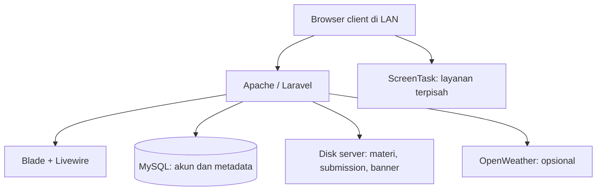

<p align="center">
  
</p>

<h1 align="center">dasar.com</h1>
<p align="center"><strong>Belajar dimulai dari dasar.</strong><br>Portal laboratorium komputer untuk materi, pengumpulan tugas, jadwal, dan informasi kegiatan.</p>
<p align="center">Laravel 12 · Livewire 4 · Tailwind CSS 4 · MySQL · Jaringan lokal</p>

---

## Tentang proyek

**dasar.com** adalah aplikasi web untuk memusatkan kegiatan laboratorium komputer dalam satu portal. Mahasiswa dapat mengambil materi praktikum, melihat jadwal, dan mengumpulkan tugas. Asisten serta admin dapat mengelola kebutuhan praktikum dan menemukan berkas mahasiswa melalui folder di komputer server.

Aplikasi dirancang untuk penggunaan di jaringan lokal (**LAN**). Satu komputer menjalankan aplikasi dan database, sedangkan komputer client mengaksesnya melalui browser. Client tidak perlu memasang PHP, Composer, Node.js, atau MySQL.

Fitur inti memakai server dan penyimpanan lokal. Widget cuaca memerlukan akses internet dari server ke OpenWeather; tautan kegiatan eksternal juga bergantung pada akses internet client. ScreenTask berjalan sebagai aplikasi terpisah yang ditautkan dari navbar.

> **Cakupan dokumentasi:** panduan ini merangkum struktur aplikasi dan pembaruan UI yang dikembangkan sampai Oktober 2026. Versi paket yang benar-benar terpasang mengikuti `composer.lock` dan `package-lock.json`. Cocokkan perubahan manual di repository dengan peta file di bawah sebelum melakukan maintenance.

## Daftar isi

- [Fitur utama](#fitur-utama)
- [Peran dan hak akses](#peran-dan-hak-akses)
- [Stack dan kebutuhan lingkungan](#stack-dan-kebutuhan-lingkungan)
- [Arsitektur dan penyimpanan](#arsitektur-dan-penyimpanan)
- [Instalasi untuk development](#instalasi-untuk-development)
- [Konfigurasi environment](#konfigurasi-environment)
- [Menjalankan aplikasi di LAN](#menjalankan-aplikasi-di-lan)
- [Peta file untuk development dan maintenance](#peta-file-untuk-development-dan-maintenance)
- [Panduan mengubah fitur](#panduan-mengubah-fitur)
- [UI, tema, logo, dan animasi](#ui-tema-logo-dan-animasi)
- [Database dan kompatibilitas data lama](#database-dan-kompatibilitas-data-lama)
- [Maintenance dan backup](#maintenance-dan-backup)
- [Pengujian](#pengujian)
- [Troubleshooting](#troubleshooting)
- [Kontribusi dan lisensi](#kontribusi-dan-lisensi)

## Fitur utama

| Modul | Kegunaan |
| --- | --- |
| Welcome | Halaman publik berisi sambutan, akses materi, gambar asisten, dan galeri kegiatan. |
| Autentikasi | Registrasi dan login dengan validasi, pembatasan percobaan, serta pemeriksaan akun aktif saat login. |
| Dashboard | Beranda pengguna setelah login, informasi kegiatan, dan widget cuaca. |
| Materi praktikum | Menjelajah folder dan mengunduh materi tanpa harus login; pengelola dapat mengelola berkas. |
| Pengumpulan tugas | Membuat tugas, memilih folder tujuan, mengatur deadline, mengunggah berkas, dan melihat status pengumpulan. |
| Jadwal praktikum | Informasi mata kuliah, kelas, semester, ruangan, pengajar, dan waktu praktikum. |
| Profil | Mengubah informasi pribadi, nomor HP, dan password. |
| Pengguna | Admin mengelola identitas, peran, serta status aktif akun. |
| Banner kegiatan | Admin/asisten mengunggah gambar, mengubah informasi, mengatur urutan, mengaktifkan, dan menghapus banner. |
| Kategori pengumpulan | Admin mengelola kategori seperti UTS, UAS, Tugas, dan Tambahan. |
| ScreenTask | Tombol untuk membuka alamat aplikasi berbagi layar yang sudah dikonfigurasi. |
| Tema dan interaksi | Tema gelap/terang, navbar kapsul saat scroll, portal login/registrasi beranimasi, dan transisi setelah autentikasi berhasil. |

## Peran dan hak akses

| Akses | Tamu | Mahasiswa | Asisten | Admin |
| --- | :---: | :---: | :---: | :---: |
| Welcome dan banner publik aktif | ✓ | ✓ | ✓ | ✓ |
| Menjelajah / mengunduh materi | ✓ | ✓ | ✓ | ✓ |
| Dashboard dan profil sendiri | — | ✓ | ✓ | ✓ |
| Melihat tugas dan jadwal | — | ✓ | ✓ | ✓ |
| Mengumpulkan tugas | — | ✓ | — | — |
| Mengunduh berkas submission | — | — | ✓ | ✓ |
| Mengelola materi, tugas, jadwal, dan banner | — | — | ✓ | ✓ |
| Mengelola kategori | — | — | — | ✓ |
| Mengelola pengguna | — | — | — | ✓ |

Nilai role dalam kode adalah `admin`, `asisten`, dan `mahasiswa`. Gate didefinisikan di `app/Providers/AppServiceProvider.php`: `manage-lab`, `manage-users`, `view-materials`, `manage-categories`, `view-assignments`, `submit-assignment`, `download-submission`, dan `view-schedules`.

Pembatasan menu di Blade bukan pengganti otorisasi backend. Pertahankan pengecekan Gate pada method Livewire, middleware route, dan controller download. `EnsureAccountIsActive` menangani status akun; periksa pendaftarannya di bootstrap middleware ketika memindahkan proyek.

**Aturan penghapusan pada kode yang diperiksa:** tugas yang sudah memiliki submission tidak dapat dihapus. Kategori yang dipakai tugas/submission juga tidak dapat dihapus. Untuk data yang sudah dipakai, tutup pengumpulan atau nonaktifkan kategori. Kode menyediakan penghapusan untuk data yang belum dipakai; jika kebijakan lab melarang penghapusan sepenuhnya, ubah backend dan UI bersama-sama.

## Stack dan kebutuhan lingkungan

| Teknologi | Versi / acuan | Fungsi |
| --- | --- | --- |
| PHP | Constraint proyek `^8.2`; lingkungan development pernah memakai 8.4.25 | Runtime backend. |
| Laravel | `^12.0`; versi yang pernah dijalankan 12.69.3 | Routing, database, validasi, session, filesystem, dan otorisasi. |
| Livewire | `^4.4` | Komponen interaktif berbasis PHP. |
| Blade | Bawaan Laravel | Template antarmuka. |
| Alpine.js | Integrasi Livewire | Menu, carousel, dan interaksi ringan di browser. |
| Tailwind CSS | `^4.3.3` pada manifest yang diperiksa | Utility CSS dan build styling. |
| Vite | `^7.0.7` pada manifest yang diperiksa | Development server dan build aset. |
| MySQL | Sesuaikan versi server dengan driver dan migration proyek | Penyimpanan data terstruktur. |
| Composer | 2.x | Dependency PHP. |
| Node.js dan npm | Versi Node yang memenuhi `engines` Vite terpasang | Build aset frontend. |
| Apache / XAMPP | Opsi server Windows untuk penggunaan LAN | Melayani aplikasi dari direktori `public`. |
| OpenWeather | API cuaca opsional | Cuaca Jakarta Barat, dengan lokasi alternatif Jakarta. |
| PHPUnit / Laravel Pint | Dependency development | Pengujian dan format kode PHP. |

Autentikasi pada source yang diperiksa menggunakan komponen Livewire dan Laravel Auth; Fortify bukan dependency di `composer.json` tersebut. Alpine tidak perlu dimuat ulang lewat CDN jika sudah disediakan Livewire.

Periksa lingkungan sebelum instalasi:

```powershell
php -v
php -m
composer --version
node -v
npm -v
```

Gunakan `composer check-platform-reqs` setelah dependency dipasang untuk memeriksa kebutuhan PHP aktual. Driver `pdo_mysql` diperlukan untuk MySQL. Pastikan PHP CLI dan PHP yang dipakai Apache memiliki konfigurasi ekstensi serta upload yang sesuai.

## Arsitektur dan penyimpanan



### Materi: folder sebagai sumber data

Root materi diatur melalui `MATERIALS_ROOT`. Isi folder dibaca oleh `app/Support/MaterialDirectory.php`; file/folder yang ditambah, diubah, atau dihapus langsung dari disk akan tercermin saat daftar dibaca ulang melalui refresh/polling halaman.

Contoh struktur yang dapat disiapkan pengelola:

```text
D:/DataLab/materi/Web Programming/
D:/DataLab/materi/Machine Learning/
D:/DataLab/materi/Basis Data/
```

Folder fisik menjadi acuan daftar materi. Keberadaan model `Material` tidak berarti semua berkas materi harus dimasukkan ke tabel terlebih dahulu. Download melalui `MaterialDownloadController`, bukan dengan mengekspos seluruh root materi sebagai folder publik web server.

### Submission: file di disk, metadata di database

`SUBMISSIONS_ROOT` berisi folder pengumpulan yang disiapkan pengelola. Pembuat tugas memilih **folder relatif yang sudah tersedia** melalui form tugas. `SubmissionDirectory` memeriksa folder agar tetap berada dalam root yang diizinkan.

Contoh folder:

```text
D:/DataLab/pengumpulan/Web Programming/Kelas A/Tugas 01/
D:/DataLab/pengumpulan/Web Programming/Kelas B/UTS/
D:/DataLab/pengumpulan/Basis Data/Kelas A/UAS/
```

Contoh nilai `submission_directory` yang disimpan: `Web Programming/Kelas A/Tugas 01`. Contoh ini adalah konvensi pengelolaan, bukan jaminan bahwa aplikasi membuat seluruh struktur otomatis.

Saat mahasiswa mengirim berkas, aplikasi menyimpan file pada disk `submissions`, lalu menyimpan nama file, path relatif, ukuran, pemilik, waktu unggah, dan status ke database. Nama tersimpan dibentuk dari NIM, nama, mata kuliah/kelas, serta timestamp.

Mahasiswa melihat konfirmasi/status pengumpulan tanpa akses download berkas submission. Admin/asisten dapat mengakses berkas sesuai otorisasi. **Menaruh file secara manual di folder submission tidak otomatis membuat status pengumpulan di database.** Menghapus atau memindahkan file langsung dari disk dapat membuat metadata mengarah ke file yang tidak ada.

Upload ulang diperbolehkan sebelum deadline. Kode menyimpan file baru dan metadata terlebih dahulu, kemudian membersihkan file lama. Pengumpulan terlambat mengikuti `allow_late`; upload ulang setelah deadline ditolak. Status yang disimpan mencakup `submitted` dan `late`.

### Banner: penyimpanan privat dengan endpoint gambar

Disk `banners` memakai `storage/app/private/banners`. Metadata banner meliputi judul, path gambar, tautan, urutan, dan status aktif. Dashboard memakai endpoint gambar terautentikasi; welcome memakai endpoint publik yang memeriksa banner aktif.

`storage:link` tidak membuat disk privat materi, submission, atau banner menjadi publik, dan bukan solusi umum untuk error pada endpoint gambar tersebut.

## Instalasi untuk development

Contoh perintah berikut memakai PowerShell dan direktori proyek `D:\_Laravel\dasar.com`. Sesuaikan alamat repository dan lokasi kerja.

```powershell
git clone <URL_REPOSITORY> dasar.com
cd dasar.com
composer install
npm ci
Copy-Item .env.example .env
php artisan key:generate
```

Gunakan `npm install` bila repository belum menyediakan `package-lock.json`, lalu simpan lockfile yang dihasilkan. Jangan mengganti `composer install` dengan `composer update` untuk instalasi rutin.

Buat database MySQL kosong, lalu isi konfigurasi `.env` sebelum menjalankan migration. Pastikan repository menyertakan **seluruh migration aplikasi**, termasuk tabel pengguna, tugas, submission, jadwal, kategori, session/cache/job sesuai driver, dan banner. Potongan source atau paket pembaruan UI tidak menggantikan repository aplikasi lengkap.

```powershell
php artisan config:clear
php artisan migrate:status
php artisan migrate
npm run build
```

Untuk instalasi database lama, baca bagian [Database dan kompatibilitas data lama](#database-dan-kompatibilitas-data-lama) terlebih dahulu.

### Menjalankan development server

Buka terminal pertama:

```powershell
php artisan serve
```

Buka terminal kedua:

```powershell
npm run dev
```

Jika aplikasi menggunakan background job, jalankan worker pada terminal tambahan:

```powershell
php artisan queue:listen --tries=1 --timeout=0
```

Alternatifnya, `composer run dev` menjalankan script yang didefinisikan dalam `composer.json`. Source yang diperiksa menjalankan server, queue, dan Vite. Cek script tersebut bila versi lokal masih memuat Laravel Pail yang bermasalah di Windows.

### Akun admin awal

Gunakan seeder akun awal jika repository menyediakan seeder yang sudah ditinjau. Jangan mengasumsikan ada kredensial admin bawaan atau menjalankan seeder contoh pada database operasional.

Jika belum ada seeder, registrasikan akun milik pengelola lalu promosikan akun yang sudah dipastikan identitasnya melalui terminal server:

```powershell
php artisan tinker
```

```php
$user = App\Models\User::where('email', 'admin@contoh.test')->firstOrFail();
$user->role = 'admin';
$user->is_active = true;
$user->save();
```

Ganti email contoh dengan akun yang benar. Pastikan migration menetapkan default registrasi sebagai mahasiswa dan status aktif sesuai kebijakan lab. Jangan menerima role admin dari input form registrasi publik.

## Konfigurasi environment

Contoh berikut berisi placeholder; tidak ada password atau API key operasional.

```dotenv
APP_NAME="dasar.com"
APP_ENV=local
APP_DEBUG=true
APP_URL=http://127.0.0.1:8000

DB_CONNECTION=mysql
DB_HOST=127.0.0.1
DB_PORT=3306
DB_DATABASE=dasardotcom
DB_USERNAME=dasar_app
DB_PASSWORD="GANTI_PASSWORD_DATABASE"

SESSION_DRIVER=database
CACHE_STORE=database
QUEUE_CONNECTION=database

MATERIALS_ROOT="D:/DataLab/materi"
SUBMISSIONS_ROOT="D:/DataLab/pengumpulan"

SCREENTASK_URL="http://192.168.1.10:8080"

OPENWEATHER_API_KEY=
WEATHER_LABEL="Jakarta Barat"
WEATHER_LAT=-6.149344
WEATHER_LON=106.721920
WEATHER_CITY="Jakarta,ID"
```

`APP_KEY` dibuat oleh `php artisan key:generate` saat instalasi baru. Jangan membuat ulang key pada instalasi aktif hanya untuk memperbaiki error biasa.

| Pengaturan | Lokasi konfigurasi | Catatan maintenance |
| --- | --- | --- |
| Database | `config/database.php` | Database, akun MySQL, host, dan port berasal dari `.env`. |
| Session / cache / queue | `config/session.php`, `config/cache.php`, `config/queue.php` | Driver database memerlukan tabel pendukung. |
| Root materi dan submission | `config/filesystems.php` | Ubah root di `.env`; siapkan folder dan izin baca/tulis akun service. |
| Banner | `config/filesystems.php` → disk `banners` | Root default tidak memakai variabel `BANNERS_ROOT`. |
| ScreenTask | `config/services.php` → `screentask.url` | Tombol hanya ditampilkan bila URL HTTP/HTTPS valid. |
| Cuaca | `config/weather.php` | Key dibaca server; jangan taruh key di Blade atau JavaScript. |

Setelah mengganti `.env`, jalankan `php artisan config:clear`. Pada server yang menggunakan config cache, bangun ulang dengan `php artisan config:cache` setelah konfigurasi benar. Worker yang sudah berjalan perlu direstart agar membaca konfigurasi baru.

Cuaca memakai koordinat Jakarta Barat. Jika koordinat kosong/tidak valid, service memakai kota Jakarta. Data berhasil di-cache sekitar 10 menit; data sebelumnya dapat dipakai sebagai fallback hingga 24 jam. Tanpa API key atau koneksi, widget dapat menampilkan status tidak tersedia tanpa menjadi syarat penggunaan fitur inti.

## Menjalankan aplikasi di LAN

### Uji sementara

Pada server development:

```powershell
php artisan serve --host=0.0.0.0 --port=8000
```

Client membuka `http://IP_SERVER:8000`, bukan `127.0.0.1` dan bukan `0.0.0.0`. Atur `APP_URL` sesuai URL yang dipakai client. Gunakan aset hasil `npm run build` agar client tidak bergantung pada Vite yang hanya mendengarkan localhost.

### Server lab dengan Apache

Document root harus mengarah ke **folder `public`**, misalnya `D:/_Laravel/dasar.com/public`, bukan root repository. Aktifkan dukungan rewrite dan izin konfigurasi `.htaccess` yang diperlukan Laravel.

Gunakan alamat IP server yang stabil. Akses nama `dasar.com` secara lokal memerlukan DNS lokal atau entri hosts pada client; nilai `APP_URL` saja tidak membuat nama domain tersebut dikenali komputer lain.

Untuk lingkungan operasional:

```dotenv
APP_ENV=production
APP_DEBUG=false
APP_URL=http://IP_ATAU_HOSTNAME_SERVER
```

Jalankan instalasi dependency dari lockfile dan build frontend pada proses deployment. Pastikan akun Windows yang menjalankan Apache dapat menulis ke `storage`, `bootstrap/cache`, root submission, dan lokasi unggahan materi. MySQL tetap dapat mendengarkan localhost jika hanya aplikasi server yang membutuhkannya.

Batasi akses web server melalui jaringan/firewall ke subnet lab. Pastikan tidak ada port forwarding yang tidak diperlukan. Menggunakan Laravel tidak otomatis membatasi aplikasi menjadi LAN-only.

Jika memakai HTTPS, sesuaikan konfigurasi cookie secure. Jangan mengaktifkan cookie secure untuk instalasi yang masih dilayani melalui HTTP karena session login dapat gagal bertahan.

## Peta file untuk development dan maintenance

### Backend dan halaman

| Yang ingin diubah | File / direktori utama |
| --- | --- |
| URL, nama route, middleware akses | `routes/web.php` dan `routes/welcome.php` pada pembaruan welcome |
| Hak akses tiap peran | `app/Providers/AppServiceProvider.php` |
| Pemeriksaan akun nonaktif | `app/Http/Middleware/EnsureAccountIsActive.php` dan pendaftarannya di `bootstrap/app.php` |
| Login / registrasi | `app/Livewire/Auth/Login.php`, `Register.php`, `Portal.php` |
| Tampilan portal autentikasi | `resources/views/livewire/auth/portal.blade.php`, `login.blade.php`, `register.blade.php` |
| Transisi login berhasil | `app/Livewire/Auth/Concerns/TransitionsAfterAuthentication.php` |
| Data welcome / banner publik | `app/Http/Controllers/WelcomeController.php`, `PublicBannerImageController.php` |
| Tampilan welcome | `resources/views/welcome.blade.php` |
| Data dashboard | `app/Http/Controllers/DashboardController.php` |
| Tampilan dashboard | `resources/views/dashboard.blade.php` |
| Daftar, pencarian, upload, rename, hapus materi | `app/Livewire/Materials/Index.php` |
| Pembacaan dan validasi path materi | `app/Support/MaterialDirectory.php` |
| Download materi | `app/Http/Controllers/MaterialDownloadController.php` |
| Form dan daftar tugas | `app/Livewire/Assignments/Index.php` |
| Detail tugas, upload ulang, penamaan file, status | `app/Livewire/Assignments/Show.php` |
| Validasi folder pengumpulan | `app/Support/SubmissionDirectory.php` |
| Download submission oleh pengelola | `app/Http/Controllers/SubmissionDownloadController.php` |
| Jadwal | `app/Livewire/Schedules/Index.php` |
| Profil dan perubahan password | `app/Livewire/Profile/Index.php` |
| Pengelolaan akun | `app/Livewire/Users/Index.php` |
| Kategori pengumpulan | `app/Livewire/SubmissionCategories/Index.php` |
| Pengelolaan banner | `app/Livewire/Banners/Index.php`, `app/Http/Controllers/BannerImageController.php` |
| Halaman menu pengelolaan | `app/Livewire/Management/Index.php` |
| Integrasi OpenWeather | `app/Support/WeatherService.php`, `app/Livewire/Dashboard/Weather.php` |
| Relasi, cast, field model | `app/Models/` |
| Perubahan skema database | `database/migrations/` |

Tampilan komponen mengikuti `resources/views/livewire/<modul>/index.blade.php`; detail tugas memakai `assignments/show.blade.php`. Cocokkan huruf besar/kecil nama path sebelum memindahkan proyek Windows ke Linux.

### Styling dan JavaScript

| Lokasi | Kegunaan |
| --- | --- |
| `resources/css/app.css` | Entry point dan urutan import CSS modular. |
| `resources/css/foundation/tokens.css` | Token warna tema, teks, border, dan elemen dasar. |
| `resources/css/foundation/base.css` | Aturan global dasar. |
| `resources/css/foundation/viewport.css` | Pengaturan skala viewport/body. |
| `resources/css/components/shared.css` | Gaya komponen yang dipakai bersama. |
| `resources/css/components/navbar.css` | Navbar normal, mobile, dan kapsul. |
| `resources/css/components/theme-toggle.css` | Kontrol tema mengambang. |
| `resources/css/pages/welcome.css` | Hero, gambar asisten, snap section, dan galeri poster. |
| `resources/css/pages/dashboard.css` | Dashboard dan area banner. |
| `resources/css/pages/auth.css` | Layout login/registrasi dan perpindahan panel. |
| `resources/css/pages/materials.css` | Halaman materi. |
| `resources/css/pages/assignments.css` | Daftar dan detail tugas. |
| `resources/css/pages/schedules.css` | Jadwal. |
| `resources/css/pages/profile.css` | Profil. |
| `resources/css/pages/admin.css` | Pengelolaan pengguna, banner, dan kategori. |
| `resources/css/pages/management.css` | Menu pengelolaan. |
| `resources/css/compatibility/` | Aturan kompatibilitas yang masih dipakai template lama. |
| `resources/js/app.js` | Entry point JavaScript Vite. |
| `public/js/dashboard.js` | Interaksi carousel dashboard pada paket UI. |
| `public/js/navbar-scroll.js` | Perpindahan navbar menjadi kapsul. |
| `public/js/auth-transition.js` | Panel transisi setelah autentikasi berhasil. |
| `public/css/auth-transition.css` | Gaya dan durasi panel transisi autentikasi. |

## Panduan mengubah fitur

### Menambah field atau fitur baru

Buat migration baru untuk perubahan skema, lalu sesuaikan model, properti/validasi Livewire, dan Blade. Jangan mengedit migration yang sudah dijalankan di server operasional untuk mengharapkan skema berubah otomatis.

Buat komponen melalui terminal:

```powershell
php artisan make:livewire NamaFitur
php artisan make:migration add_keterangan_to_assignments_table --table=assignments
```

Struktur hasil generator bergantung pada konfigurasi Livewire yang terpasang. Periksa hasilnya dan ikuti pola komponen kelas di `app/Livewire` serta Blade di `resources/views/livewire` yang digunakan proyek. Tambahkan route dan otorisasi sebelum mengekspos fitur baru.

### Memindahkan folder materi atau tugas

Salin data ke root baru dan pertahankan struktur folder relatif. Ubah `.env`, bersihkan config cache, lalu uji pembacaan, upload, dan download. Jangan menghapus lokasi lama sebelum data hasil pemindahan diverifikasi.

Untuk submission, `submission_directory` dan `file_path` tetap menunjuk lokasi relatif. Mengubah nama subfolder di tengah struktur membutuhkan penyesuaian referensi database; mengganti root saja tidak memperbaiki path relatif yang berubah.

### Mengubah batas atau format upload

Source yang diperiksa membatasi materi dan submission sekitar **10 MB**, sedangkan banner sekitar **5 MB**. Materi/submission menerima format dokumen dan arsip yang tercantum pada rules; banner menerima JPG/JPEG/PNG/WebP.

Sesuaikan secara bersamaan:

1. Rules `max`, `mimes`, dan `extensions` pada komponen terkait.
2. Batas temporary upload Livewire; periksa `config/livewire.php` bila sudah dipublikasikan, atau konfigurasi efektif paket bila belum ada.
3. `upload_max_filesize` dan `post_max_size` pada PHP yang melayani web.
4. Batas request web server/proxy dan pesan bantuan di Blade.

Jangan menganggap ekstensi filename cukup untuk memvalidasi isi file. Jangan menyediakan file submission sebagai URL publik hanya untuk mempermudah download.

### Mengubah kategori dan aturan deadline

Form kategori berada di `SubmissionCategories/Index.php`; aturan aksesnya `manage-categories`. Aturan menerima submission berada di `Assignment::acceptsSubmissions()` dan pemeriksaan tambahan saat upload di `Assignments/Show.php`.

Simpan aturan waktu secara konsisten. Kode submission menggunakan waktu UTC untuk metadata unggah dan zona `Asia/Jakarta` untuk bagian timestamp nama file. Periksa juga konversi input deadline dan tampilan saat mengubah pengaturan timezone.

## UI, tema, logo, dan animasi

### Mengubah warna atau komponen

Utamakan token di `foundation/tokens.css`, misalnya `--page`, `--card`, `--text`, `--muted`, `--line`, dan `--link`. Ubah CSS halaman pada modul terkait, bukan menumpuk override di akhir `app.css`.

Urutan import adalah bagian dari cascade. Jangan menghapus folder `compatibility` atau memindahkan semua aturan ke CSS layer baru tanpa mengaudit template pemakainya. Jika `docs/CSS_GUIDE.md` dari paket refactor sudah disalin ke repository, gunakan panduan tersebut sebagai referensi lebih rinci.

### Logo README, favicon, dan gambar hero

Aktifkan blok logo yang dikomentari di bagian atas README ini, lalu ganti `public/images/logo-dasar.svg` sesuai file logo repository. GitHub membaca path file repository, bukan helper Blade `asset()`.

Untuk ikon tab browser, simpan `public/favi.ico`, lalu letakkan pada `<head>` layout:

```blade
<link rel="icon" type="image/x-icon" href="{{ asset('favi.ico') }}?v=1">
```

Ganti deklarasi favicon lama bila sudah ada. Naikkan versi query saat mengganti ikon dan browser masih menampilkan cache lama. Logo navbar diatur melalui `resources/views/components/layouts/app.blade.php`; gunakan SVG/PNG berkualitas untuk logo besar. Hero welcome memakai `public/images/asisten.png` dan aturan `.welcome-visual` pada `pages/welcome.css`.

### Tema

Bootstrap tema berada di `resources/views/components/theme-script.blade.php`, sedangkan tombolnya di `theme-toggle.blade.php`. Pertahankan bootstrap awal agar pergantian tema tidak menyebabkan kilatan warna saat halaman dimuat. Lokasi tombol mengambang diatur CSS komponen dan layout.

### Navbar kapsul

Navbar awal ikut tergulir. Setelah keluar layar, `navbar-scroll.js` mengubah elemen yang sama menjadi fixed dan berbentuk kapsul. Pembungkus mempertahankan tinggi awal untuk menghindari loncatan konten.

Durasi masuk berada pada `.lab-navbar.is-floating` di `components/navbar.css` (default paket: `380ms`). Ambang muncul berada pada pemeriksaan posisi `bottom` di JS. Breakpoint menu pada CSS harus selaras dengan handler resize Alpine di layout.

### Transisi login dan registrasi

`TransitionsAfterAuthentication` dipanggil setelah autentikasi berhasil dan session diregenerasi. JS menutup layar dengan panel, menuju URL tujuan, lalu membuka panel. Login tetap memakai intended URL; registrasi menuju dashboard. Validasi gagal tidak memicu transisi.

Durasi tiap gerakan berada pada:

```css
/* public/css/auth-transition.css */
:root {
    --auth-transition-duration: 320ms;
}
```

JS membaca variabel tersebut. Aset ini dimuat langsung dari `public`, bukan build Vite; naikkan query versi pada layout jika perlu memperbarui cache browser. Pertahankan fallback navigasi, reset saat kembali melalui browser, dan dukungan `prefers-reduced-motion`.

### Carousel welcome dan dashboard

Welcome memakai Alpine di `welcome.blade.php` dan CSS `pages/welcome.css`. Versi galeri terbaru memakai slide terpusat, preview slide tetangga, backdrop blur dekoratif, dan poster utama `object-fit: contain`. Navigasi dihitung dari pusat elemen slide. Mengubah lebar slide tanpa menyesuaikan perhitungan scroll dapat merusak snap.

Carousel welcome dikendalikan manual melalui swipe, tombol, atau keyboard. Autoplay dashboard diatur pada implementasi `public/js/dashboard.js`; jangan menganggap kedua carousel memiliki mekanisme yang sama. Pertahankan link gambar asli dan pembatasan banner publik aktif.

## Database dan kompatibilitas data lama

| Model | Peran data |
| --- | --- |
| `User` | Identitas akun, kredensial, NIM, role, status aktif, dan data profil. |
| `Assignment` | Tugas, pembuat, kategori, mata kuliah/kelas, deadline, status buka, dan folder tujuan. |
| `Submission` | Pengumpulan pengguna, path file, metadata unggah, dan status ketepatan waktu. |
| `SubmissionCategory` | Kategori pengumpulan. |
| `Schedule` | Jadwal praktikum. |
| `Banner` | Metadata gambar kegiatan. |

Relasi utama: assignment memiliki banyak submission; submission dimiliki user dan assignment serta merujuk kategori. Tabel pendukung session, cache, dan queue mengikuti driver yang dipilih.

Kolom nomor telepon profil memakai **`no_hp_mhs`** untuk menjaga kesesuaian dengan struktur lama. Jangan menggantinya menjadi `phone` hanya di form tanpa migration atau pemetaan data. Kelas disimpan dalam konteks tugas/jadwal; jangan menganggap kelas mahasiswa bersifat tetap lintas semester.

Impor akun lama **bukan syarat** menjalankan fitur saat ini. Jika migrasi data lama dilakukan nanti, kerjakan pada salinan database: petakan kolom, periksa duplikasi email/NIM, role, format hash password, foreign key, dan default akun. Jangan memasukkan dump berisi data pengguna ke repository publik.

Sebelum memakai database yang sudah berisi data, periksa `php artisan migrate:status` dan skema aktual. Jangan menjalankan `migrate:fresh`, `db:wipe`, atau seeder destruktif pada database operasional. Source parsial tidak cukup untuk menyimpulkan bahwa seluruh migration instalasi baru sudah tersedia.

## Maintenance dan backup

### Perubahan harian

| Perubahan | Langkah lanjutan |
| --- | --- |
| Blade | Refresh; gunakan `php artisan view:clear` bila tampilan masih memakai cache. |
| CSS / JS melalui Vite | `npm run dev` saat development atau `npm run build` untuk deployment. |
| Aset langsung dalam `public` | Refresh cache / naikkan versi URL aset. |
| `.env` atau config | Clear/rebuild config cache; restart proses persisten yang terkait. |
| Route | Bersihkan route cache bila digunakan; verifikasi `php artisan route:list`. |
| Migration | Backup, tinjau migration, lalu `php artisan migrate`. |
| Dependency | Gunakan lockfile; upgrade dependency sebagai pekerjaan terpisah dengan pengujian. |

### Backup yang diperlukan

Backup database **dan** root materi, root submission, serta `storage/app/private/banners`. Simpan `.env` dan `APP_KEY` secara privat bersama catatan versi kode dan konfigurasi server. Backup database tanpa file fisik tidak cukup untuk memulihkan download tugas atau gambar.

Jadwalkan backup ketika penulisan data berhenti atau gunakan mekanisme snapshot yang konsisten. Uji restore ke lingkungan terpisah: login, daftar tugas, file submission, dan gambar banner harus benar-benar dapat dibuka.

### Prosedur update server

Sebelum update, buat backup yang bisa dipulihkan dan catat versi sebelumnya. Untuk perubahan yang memerlukan penghentian sementara, gunakan maintenance mode. Sinkronkan kode, jalankan `composer install` sesuai lockfile, build aset, tinjau/jalankan migration yang diperlukan, dan perbarui cache yang digunakan. Restart queue worker jika ada. Akhiri maintenance mode dengan `php artisan up`, lalu lakukan smoke test dari PC client.

Jangan mengandalkan rollback kode untuk membalik perubahan database yang destruktif. Rencana pemulihan harus mencakup database dan berkas fisik dari waktu yang konsisten.

Log aplikasi berada di `storage/logs/laravel.log`; untuk masalah web server, periksa log Apache juga. Jangan membagikan log yang memuat kredensial, cookie session, token, atau data pribadi.

## Pengujian

```powershell
php artisan route:list
php artisan migrate:status
composer check-platform-reqs
php artisan test
npm run build
```

Jalankan automated test pada environment testing dengan database terpisah; periksa `.env.testing` / `phpunit.xml` sebelum menjalankan test yang dapat mengubah data. Keberadaan PHPUnit tidak berarti semua fitur sudah memiliki test otomatis.

Smoke test setelah perubahan besar:

- Tamu dapat membuka materi dan banner welcome aktif, tetapi tidak mengakses halaman tugas/profil.
- Mahasiswa dapat mengumpulkan tugas ke folder terpilih dan melihat status; akses langsung ke endpoint download submission ditolak.
- Admin/asisten dapat mengelola fitur sesuai Gate; hanya admin mengelola pengguna/kategori.
- Akun nonaktif, password salah, dan rate limit ditangani tanpa menjalankan transisi sukses.
- Folder tujuan yang hilang, file terlalu besar, format salah, deadline, upload ulang, dan file yang gagal ditulis menghasilkan pesan yang tepat.
- Banner kosong, satu, dan banyak tampil benar; poster portrait/landscape tetap terbaca.
- Navbar, tema, portal auth, galeri, dan reduced motion bekerja pada desktop serta HP.
- PC client mengakses aplikasi memakai alamat server; download, upload, serta ScreenTask bekerja dari client, bukan hanya dari server.

Uji UI dengan fixture atau kompilasi CSS tidak menggantikan pengujian Laravel, database, izin filesystem, dan jaringan nyata.

## Troubleshooting

| Gejala | Yang diperiksa |
| --- | --- |
| MySQL `Access denied`, `using password: NO` | Periksa `DB_USERNAME`, `DB_PASSWORD`, service/port MySQL, lalu config cache. Jangan mengasumsikan root selalu tanpa password. |
| Tabel `sessions` / `cache` tidak ditemukan | Cocokkan driver `.env` dengan migration yang tersedia dan sudah dijalankan. |
| `Failed to listen` saat `artisan serve` | Periksa port yang dipakai/dibatasi Windows; coba `php artisan serve --port=8081` untuk diagnosis. |
| Materi tidak muncul | Root `.env`, keberadaan folder, izin akun service, dan hasil pembacaan `MaterialDirectory`. |
| Upload gagal padahal file kecil | Rules komponen, temporary upload Livewire, PHP web-server, izin tulis, disk penuh, dan session. |
| Submission tercatat tetapi download 404 | Cocokkan `file_path` dengan berkas pada root submission; periksa pemindahan manual dan hasil restore. |
| Banner gagal dibuka | Disk `banners`, `image_path`, endpoint yang digunakan, status aktif untuk rute publik, dan middleware. |
| Welcome kehilangan variabel `$banners` | Route home harus menuju `WelcomeController`, bukan `Route::view` lama tanpa data. |
| Route home ganda | Pada paket welcome, gunakan `require __DIR__.'/welcome.php';` sekali di `routes/web.php` dan hapus definisi home lama. |
| ScreenTask tidak muncul | `SCREENTASK_URL` valid HTTP/HTTPS dan config cache; jangan memasukkan URL eksternal ke `route()`. |
| Cuaca tidak tersedia | Key, koneksi internet server, koordinat/kota, respons API, serta cache; jangan tampilkan key di log. |
| CSS lama masih terlihat | Pastikan modul diimpor, build selesai, lalu refresh cache browser. |
| Vite berjalan di server tetapi client gagal memuat aset | Pakai build frontend untuk LAN atau konfigurasikan akses Vite secara sengaja; periksa file `public/hot` yang tertinggal. |
| `Undefined variable $assignment` | Cocokkan data dari render dengan scope loop/variabel pada Blade. |
| `HasMany` dianggap `App\Models\HasMany` | Import `Illuminate\Database\Eloquent\Relations\HasMany` pada model. |
| `Cannot redeclare class` dalam file Blade | Pisahkan class controller ke `app/Http/Controllers`; jangan tempel deklarasi class ke view. |
| ParseError `expecting endif` | Periksa pasangan directive Blade dan ekspresi atribut Alpine; gunakan `x-on:` bila sintaks singkat membingungkan parser. |

## Kontribusi dan lisensi

Untuk perubahan baru, jelaskan masalah, perilaku yang diubah, file terdampak, dan hasil pengujiannya pada pull request. Sertakan migration ketika mengubah skema, perbarui README ketika mengubah konfigurasi/hak akses, dan hindari commit `.env`, API key, file tugas mahasiswa, dump database, `vendor`, atau `node_modules`.

Status lisensi proyek mengikuti file `LICENSE` yang ditetapkan pemilik repository. Lisensi dependency tetap mengikuti masing-masing paket; metadata scaffold Laravel tidak otomatis menentukan izin penggunaan kode dan aset tambahan proyek. Tentukan lisensi proyek sebelum memberi klaim penggunaan ulang kepada publik.

---

<p align="center">dasar.com — Ruang belajar. Ruang berkembang.</p>
